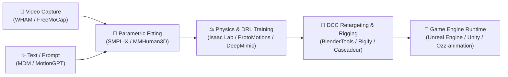

# 🏃‍♂️ Awesome Physics-Based Character Animation & Motion

### 🎮 The Definitive Ecosystem of SaaS Platforms, Neural Motion Synthesis, and DRL Character Controllers

  A curated directory of bleeding-edge <b>SaaS products</b>, <b>open-source AI frameworks</b>, and <b>simulation libraries</b> for <b>physics-based character animation</b>, <b>markerless motion capture (mocap)</b>, <b>deep reinforcement learning (DRL) locomotion</b>, and <b>neural motion diffusion</b>.

---

## 📑 Table of Contents

- [🌐 Sector Overview & Market Dynamics](#-sector-overview--market-dynamics)
- [💼 SaaS & Commercial Hosted Platforms](#-saas--commercial-hosted-platforms)
- [💻 Open-Source GitHub Projects & Frameworks](#-open-source-github-projects--frameworks)
- [🛠️ Pipeline Architecture & Integration Guide](#️-pipeline-architecture--integration-guide)
- [🤝 How to Contribute](#-how-to-contribute)
- [⚖️ Disclaimer & Licensing](#️-disclaimer--licensing)

---

## 🌐 Sector Overview & Market Dynamics

The global **3D character animation software market** is estimated at **$28B – $36B (2025–2026)** with an annual growth rate (CAGR) of ~12%–13%, while the specialized **3D motion capture and neural simulation sub-sector** is valued at **$320M – $390M**, expanding rapidly with computer vision and embodied AI adoption.

The character animation and motion synthesis ecosystem exhibits a **hybrid two-tier structure: moderately concentrated in foundational infrastructure and highly fragmented across application-layer tools**. While enterprise software giants (Adobe, Autodesk) maintain dominant footholds in foundational authoring pipelines, the markerless mocap and generative motion sector is heavily fragmented among agile startups (Cascadeur, Move.ai, DeepMotion, Plask) and an exploding open-source AI community (MediaPipe, SMPL-X, Isaac Lab, WHAM), preventing a winner-take-all monopoly and driving rapid technical innovation.

---

## 💼 SaaS & Commercial Hosted Platforms

The following SaaS and hosted platforms offer AI-assisted keyframing, cloud markerless motion capture, and neural rigging. The table is ranked in **descending order by company scale (valuation or parent company market cap / revenue)**.

| 🏢 Platform | 📝 Core Capabilities | 💰 Pricing (Starting Tier) | 🎁 Free Tier Limits / Trial | 📊 Company Scale (Valuation / Revenue) |
| :--- | :--- | :--- | :--- | :--- |
| **[Adobe Mixamo](https://mixamo.com)** | 🦴 Cloud auto-rigging and curated 3D mocap animation library with FBX/Collada exports | **Free** ($0 / month with Adobe ID) | **Unlimited 100% Free Forever** (Unlimited rigging and FBX downloads for personal & commercial use; no standalone asset reselling) | **Adobe Market Cap: ~$215B+** (Acquired Mixamo in 2015; CC ARR >$15B) |
| **[Wonder Dynamics (Autodesk Flow Studio)](https://wonderdynamics.com)** | 🎬 Cloud AI visual effects pipeline automatically animating, lighting, and compositing 3D CG characters into single-camera video | **$10 / month** (Lite plan, billed annually) | **300 credits / month Free Forever** (Max 720p export with watermark, 1-person mocap tracking, ~15-30 sec processing/mo, 1 GB storage) | **Autodesk Market Cap: ~$55B+** (Acquired Wonder Dynamics in May 2024; prior venture funding $12.5M) |
| **[Cascadeur](https://cascadeur.com)** | 🤸 Physics-assisted 3D keyframe animation software utilizing rigid-body physics, center-of-mass trajectory prediction, and auto-posing | **$8.25 / month** ($99 / year billed annually for Indie license) | **Free Forever Plan** (Full core physics toolset access; restricted strictly to non-commercial use and proprietary `.casc` format export only) | **Parent Nekki Revenue: ~$20M – $25M ARR** (Bootstrapped, 1B+ game downloads, $1.5M+ dedicated Cascadeur R&D budget) |
| **[Rokoko Studio & Vision](https://rokoko.com)** | 🦿 Hybrid mocap platform combining inertial Smartsuit Pro tracking with single-camera AI video mocap and studio cleanup | **$20 / month** ($240 / year billed annually for Plus plan) | **Free Starter Plan** (Standard FBX recording and export; capped at 30 seconds of AI video processing per month and 3 actor profiles) | **Valuation: ~$50M – $100M** (Series A; ~$14.9M total VC funding raised, estimated ~$10M–$17M ARR) |
| **[Kinetix](https://kinetix.tech)** | 🕹️ No-code cloud AI emote generation and 3D character animation SDK for games and virtual worlds | **Free SDK / Tiered Plans** (Developer commercial licensing starts on custom/SDK tiers) | **Free Creator Tier** (Free video-to-animation emote conversion and testing via Unity SDK and web app for indie creators) | **Valuation: ~$25M – $35M** ($11.6M total funding raised led by Top Harvest, The Sandbox, and ZEPETO; ~$6.9M estimated ARR) |
| **[Move.ai](https://move.ai)** | 📱 Single-cam iPhone (Move One) and multi-camera markerless 3D motion capture producing game-ready skeletal rigs | **$18 / month** (Move One Starter plan; includes 60 credits/mo) | **30 Free One-Time Credits** (Free account signup bonus; non-expiring, max 30-second recording length per clip, Gen1/Gen2 tracking) | **Acquired by Oxford Metrics for ~£725K** (Peak private valuation was ~£35M with $17.4M raised; ARR ~£1.1M) |
| **[Anything World](https://anything.world)** | 🤖 Generative AI automated rigging, physics behaviors, and real-time 3D animation runtime for Unity and Unreal Engine | **$19.99 / month** (Pro Tier for expanded API usage) | **Free Community Plan** (Free monthly allowance of automated rigging API requests and model browser imports with overage alerts) | **Valuation: ~$15M – $25M** ($9.3M total VC funding raised from Acrew Capital, Warner Music, and Alumni Ventures) |
| **[DeepMotion (Animate 3D & SayMotion)](https://deepmotion.com)** | 🏃 AI video mocap and text-to-motion platform featuring physical ground-contact simulation and full-body/face/hand tracking | **$15 / month** ($9 / month billed annually for Starter plan) | **25 Free Credits / month** (Max 20 sec per clip, 1080p@30fps, non-commercial; earn up to 100% credits back via labeling program) | **Valuation: ~$12M – $20M** ($8.7M total venture funding from Samsung Ventures, Bandai Namco 021 Fund, and Scrum Ventures) |
| **[Plask](https://plask.ai)** | 🌐 Browser-based cloud AI motion capture studio and retargeting workspace for indie animators | **$18 / month** (Standard plan billed annually) | **Free Freemium Tier** (15 seconds of motion capture processing daily or token allotment, 1 GB cloud storage, non-commercial use) | **Valuation: ~$8M – $15M** ($2.56M Pre-Series A funding from Smilegate Investment, Naver D2SF, and KT Investment) |

---

## 💻 Open-Source GitHub Projects & Frameworks

A comprehensive list of premier open-source libraries for physics-based character control, deep reinforcement learning (DRL), generative human motion models, and rigging tools. **Ranked in descending order by GitHub Stars ⭐**.

| 📦 Repository & Framework | ⭐ Stars | 🛠️ Core Focus & Tech Stack | 📖 Overview & Capabilities |
| :--- | :--- | :--- | :--- |
| **[Google MediaPipe](https://github.com/google-ai-edge/mediapipe)** |  | ⚡ Vision ML / Pose Tracking | Cross-platform, ultra-fast real-time 3D skeletal landmark, face mesh, and hand tracking library running on mobile, web, and desktop. |
| **[FreeMoCap](https://github.com/freemocap/freemocap)** |  | 🎥 Markerless Multi-Cam Mocap | Free, open-source multi-camera markerless motion capture system built for animators, biomechanists, and game developers without proprietary suits. |
| **[Isaac Lab](https://github.com/isaac-sim/IsaacLab)** |  | 🦾 GPU Robotics & Physics RL | NVIDIA's unified GPU-accelerated simulation framework built on Omniverse Isaac Sim for training agile humanoid locomotion and manipulation. |
| **[KalidoKit](https://github.com/yeemachine/kalidokit)** |  | 🎭 Web Kinematics / VTuber | Blendshape and inverse kinematics (IK) solver mapping MediaPipe and TensorFlow.js facial landmarks and poses directly to 3D VRM characters. |
| **[Motion Diffusion Model (MDM)](https://github.com/GuyTevet/motion-diffusion-model)** |  | 🌪️ Generative Diffusion AI | Foundational PyTorch diffusion model generating diverse, physically realistic 3D human motion sequences from free-form natural language text prompts. |
| **[Epic Games BlenderTools](https://github.com/EpicGames/BlenderTools)** |  | 🔌 Rigging & Engine Bridge | Official add-ons (Send to Unreal, UE to Rigify) facilitating seamless skeletal mesh and animation roundtripping between Blender and Unreal Engine. |
| **[Ozz-animation](https://github.com/guillaumeblanc/ozz-animation)** |  | ⚡ C++ Runtime Animation | Production-grade, SIMD-optimized, cache-friendly C++ skeletal animation library supporting cross-fading, additive blending, and two-bone IK. |
| **[DeepMimic](https://github.com/xbpeng/DeepMimic)** |  | 🤸 Physics DRL Locomotion | Foundational deep reinforcement learning framework enabling physically simulated characters to imitate dynamic athletic reference mocap skills. |
| **[IsaacGymEnvs](https://github.com/isaac-sim/IsaacGymEnvs)** |  | 🎮 Massively Parallel Simulation | End-to-end GPU-parallelized physics environment powering Adversarial Motion Priors (AMP) and high-speed character controller training at 100,000+ FPS. |
| **[SMPL-X](https://github.com/vchoutas/smplx)** |  | 🧍 Parametric Body Modeling | Standard expressive 3D parametric human model capturing body shape, articulation, expressive facial gestures, and natural hand poses. |
| **[ProtoMotions](https://github.com/NVlabs/ProtoMotions)** |  | 🤖 Unified Humanoid Control | NVIDIA Research framework for training physically simulated humanoids across diverse benchmark controllers including DeepMimic, AMP, and PHC. |
| **[MotionGPT](https://github.com/OpenMotionLab/MotionGPT)** |  | 💬 LLM Motion Synthesis | Unified multi-modal motion-language model treating 3D human motion as discrete vocabulary tokens for text-to-motion, captioning, and completion. |
| **[4D-Humans (HMR 2.0)](https://github.com/shubham-goel/4D-Humans)** |  | 📹 Video Mesh Recovery | Transformer-based human mesh recovery reconstructing accurate 3D SMPL mesh sequences from monocular wild in-the-wild video. |
| **[Ubisoft La Forge Animation Dataset (LAFAN1)](https://github.com/ubisoft/ubisoft-laforge-animation-dataset)** |  | 📊 High-Quality Motion Dataset | Benchmark mocap dataset and transition-inbetweening algorithms for high-speed dynamic maneuvers, rolling, and obstacle navigation. |
| **[HumanML3D](https://github.com/EricGuo5513/HumanML3D)** |  | 🗄️ Motion-Language Benchmark | The gold-standard 3D human motion-language dataset uniting AMASS and HumanAct12 with fine-grained natural language textual annotations. |
| **[MMHuman3D](https://github.com/open-mmlab/mmhuman3d)** |  | 🔬 OpenMMLab 3D Human Toolset | PyTorch toolbox for 3D human body reconstruction, pose estimation, parametric mesh fitting, and unified visualization pipelines. |
| **[Perpetual Humanoid Control (PHC)](https://github.com/ZhengyiLuo/PHC)** |  | 🏃 Perpetual RL Controller | Physics-based character controller capable of tracking hours of unconstrained diverse mocap in Isaac Gym without resetting or falling. |
| **[WHAM](https://github.com/yohanshin/WHAM)** |  | 🌍 World-Grounded Video Mocap | World-grounded 3D human motion recovery combining camera odometry, trajectory estimation, and foot-contact dynamics from mobile video. |
| **[Adversarial Skill Embeddings (ASE)](https://github.com/nv-tlabs/ASE)** |  | 🧠 Latent Motor Skills | NVIDIA framework learning versatile, reusable, physically simulated latent motor control policies for interactive, game-like character control. |
| **[Fairmotion](https://github.com/facebookresearch/fairmotion)** |  | 📐 Meta Motion Toolset | Meta AI Research library offering PyTorch primitives to load, process, visualize, and train deep models on BVH, SMPL, and ASF mocap data. |
| **[ACTOR](https://github.com/Mathux/ACTOR)** |  | 🎬 Action-Conditioned VAE | Generative transformer-based VAE for action-conditioned 3D human motion generation with variable sequence durations. |
| **[OpenCap Core](https://github.com/opencap-org/opencap-core)** |  | 🏥 Biomechanics & Dynamics | Stanford NMBL open-source processing pipeline computing 3D kinematics and musculoskeletal inverse dynamics from dual-smartphone video. |

---

## 🛠️ Pipeline Architecture & Integration Guide

For developers and technical artists building physical animation systems, here is an end-to-end integration stack:

1. **Ingestion & Extraction**: Use **WHAM** or **FreeMoCap** to extract 3D world-space joint trajectories and contact ground vectors from raw camera feeds.
2. **Generative Synthesis**: Employ **Motion Diffusion Model (MDM)** or **MotionGPT** to produce customized animation clips from text prompts.
3. **Physical Grounding & Dynamic Policy**: Train balance and obstacle-avoidance controllers in **Isaac Lab / IsaacGymEnvs** via **Adversarial Motion Priors (AMP)** or **Perpetual Humanoid Control (PHC)**.
4. **Rig Retargeting**: Clean and retarget skeletal sequences in **Blender** using **EpicGames BlenderTools** or **Cascadeur**.
5. **Runtime Deployment**: Execute cache-friendly, ultra-low latency playback inside your game engine using **Ozz-animation** or native Unreal/Unity active ragdoll graphs.

---

## 🤝 How to Contribute

Contributions are welcome! Help keep this repository the primary resource for physics-based character animation and embodied motion synthesis:

1. 🍴 **Fork the repository** on GitHub.
2. 🌿 **Create a new branch**: `git checkout -b feature/add-new-animation-tool`.
3. 📝 **Add entries** following the tabular format:
   - For SaaS tools: Name, capabilities, starting tier price, specific free tier limits, and valuation/scale.
   - For Open-Source: Name, star badge with `style=social&color=white` linking to the stargazers page, tech stack, and summary.
4. 🚀 **Submit a Pull Request** with a concise description of why the tool qualifies.

---

## ⚖️ Disclaimer & Licensing

- This curated list is maintained for educational, research, and technical artist workflow discovery.
- **Parametric Body Models**: Tools utilizing SMPL, SMPL-X, or MANO are governed by their respective academic research licenses. Always review commercial terms prior to game or film asset deployment.
- **Physics Contact Cleansing**: Markerless optical pipelines may require ground-penetration resolution or foot-skate cleanup in Cascadeur or Blender before production rendering.

---

**⭐ Star this repository if you find it valuable for your animation and physics pipeline! ⭐**

